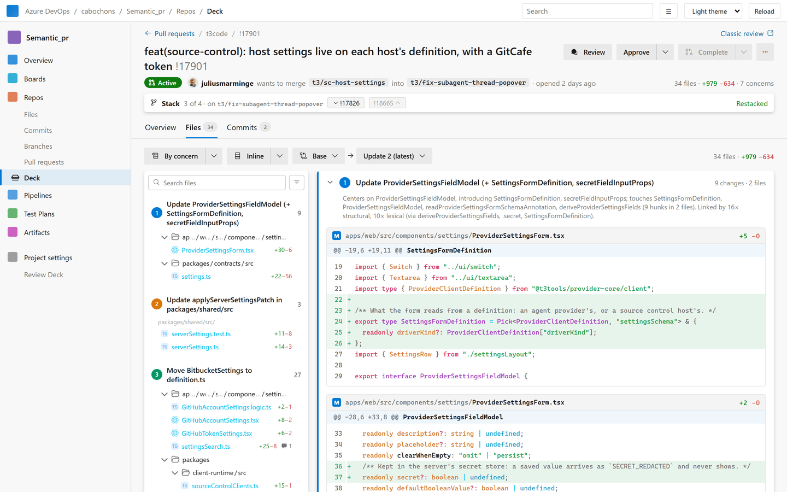

#  Review Deck

Review Deck is an Azure DevOps extension that replaces the pull request pages with a faster review page.
Instead of listing changed files alphabetically, it groups the diff by concern. Hunks that change the same
thing end up together, ordered so definitions come before their uses and code comes before its tests.



- **A PR hub:** an inbox of the pull requests that involve you (needs your review, returned to you,
  approved, drafts…), with search, filters and keyboard navigation.
- **A review page:** Overview, Files and Commits. Files opens in the **Guided** view, grouped by concern,
  with a Files A–Z toggle and inline or side-by-side diffs.
- **GitHub-style reviews:** draft comments, then submit them all with a verdict.
- **Stacked PRs:** PRs that target another PR's branch show as a stack.
- **A Changelog hub (Repos › Changelog):** a repository's release tags as cards, each with a changelog
  generated from conventional commits and the artifacts of its publishing pipeline.

Grouping runs in your browser. Review Deck reads files through the Azure DevOps REST API with your own
session and never sends code anywhere, unless you connect [your own backend](#optional-run-your-own-backend).

Created in [T3 Code](https://t3.codes).

- [Install the extension](#install-the-extension)
- [Test it locally](#test-it-locally)
- [Optional: run your own backend](#optional-run-your-own-backend)
- [How grouping works](#how-grouping-works)
- [Development](#development)

## Install the extension

### From the Visual Studio Marketplace

1. Open [Review Deck on the Marketplace](https://marketplace.visualstudio.com/items?itemName=Cabochonio.review-deck)
   and choose **Get it free**.
2. Pick your Azure DevOps organization and install it. You need to be a Project Collection Administrator,
   or ask one to approve the request.
3. Open **Repos → Deck** in any project, or open a pull request and choose **⋯ → Open in Review Deck**.

It works right away, without a backend: hunks are grouped by code structure and get rule-based titles.

Organization administrators set what applies to every project in **Organization settings → Review Deck**:
- **Deck and Changelog**: for each, either on or off for every project, or on or off by default with each
  project choosing. The project list switches a feature for one project. A turned-off hub disappears from
  the Repos menu.
- **AI group titles**: turning them off overrides every project's choice. The switch is kept by the extension in
  the browser; to make sure no code can reach a model, deploy the backend with `titles_model = null`.
- **Backend**: see [Optional: run your own backend](#optional-run-your-own-backend).

Project administrators set the rest in **Project settings → Review Deck**:
- **Deck and Changelog**: switch them for the project, unless the organization set them for every project.
- **Trunk branches**: where stacks end (`main`, `dev`, `release/*`…).
- **Changelog**: the tag convention and publishing pipeline per repository.
- **AI group titles**: whether this project sends changed lines to the backend's model.

### Your own private copy

To change the extension or run your own build:

1. Create a publisher on the [Marketplace management portal](https://marketplace.visualstudio.com/manage/publishers).
2. Put its ID in `publisher` in `extension/vss-extension.json`.
3. Build the package:

   ```sh
   npm install
   npm run ext:package     # extension/<publisher>.review-deck-<version>.vsix
   ```

4. Upload the `.vsix` as a new extension in the portal, share it with your organization (⋯ → **Share/Unshare**),
   then install it from **Organization settings → Extensions → Shared**.

A copy published under another publisher is served from `https://<publisher>.gallerycdn.vsassets.io`. If
you also run a backend, add that origin to `allowed_origins` in `infra/variables.tf`.

## Test it locally

You don't need an Azure DevOps organization to try it. The dev server wraps the page in a fake Azure
DevOps frame, with mock data and in-memory writes.

Prerequisites: Node.js 24 or later (`nvm use` picks it from `.nvmrc`). With an older npm, `npm ci` fails
on the lock file.

```sh
npm install
npm run ext:demo     # fictional demo data -> extension/dev-data
npm run ext:dev      # build, watch and serve
```

Then open <http://127.0.0.1:5173/dev/>:
- **Repos → Deck** is the PR hub. Open any PR to see the review page.
- **Project settings → Review Deck** and **Organization settings → Review Deck** are the settings pages.
- The theme menu switches between the light and dark Azure DevOps themes.
- The page reloads on every rebuild. The URL follows the page (`?pr=…&repo=…`), so reloads keep your place.
- Comments, votes and other writes stay in memory. Reloading resets them.

Other mock data:
- `npm run ext:mock` builds a 63-PR list and three full snapshots from real [T3 Code](https://github.com/pingdotgg/t3code)
  pull requests instead. It needs the `gh` CLI and network access, and makes a blobless clone in `.cache/repos`.
- `npx tsx scripts/build-stack-mock.ts` turns demo PRs into stacks.
- `npx tsx scripts/build-huge-mock.ts` adds a 990-file, 3,090-hunk PR (`!99999`) for performance work.

Checks:

```sh
npm run typecheck          # the shared pipeline (src/)
npm run ext:typecheck      # the extension
npm run backend:typecheck  # the backend
npm run ext:test           # extension and backend unit tests
just check                 # all of the above, if you have just
```

For browser failure tests, run `npm run ext:test:browser` while `npm run ext:dev` is running, then open
<http://127.0.0.1:5173/test-dist/index.html>. `window.reviewTest` can fail or pause the next write
(`failWrite`, `failRefresh`, `pauseWrite` then `resume()`).

### The grouping pipeline on its own

The same pipeline also runs from the command line and writes self-contained HTML pages, which makes it
quicker to tune:

```sh
npm run review                                   # every fixture PR -> out/<pr>.html + out/index.html
npm run review -- pr2 pr5 --embeddings           # selected PRs, with local MiniLM embeddings
npm run review -- --embeddings --llm claude      # LLM titles through `claude -p` (or --llm codex)
npm run review -- --repo <path> --commit <sha>   # any local git repo: <sha>^..<sha>
npm run review -- --repo <path> --base main --head feature --name my-pr

npm run eval                                     # grouping scores against hand-written truth
npm run debug -- pr6 --embeddings                # per-hunk facts, pair scores and merges
```

Everything runs locally: tree-sitter in WASM, and embeddings through transformers.js on the CPU. The only
network access is the one-time download of the embedding model.

## Optional: run your own backend

The extension is complete without a backend. There's no shared, hosted backend: each organization that
wants these extras deploys its own, in its own Azure subscription, and connects it in the settings.

| Feature | Without a backend | With a backend |
| --- | --- | --- |
| Grouping | Code structure, names and paths | Also sentence embeddings, for more accurate groups |
| Group titles | Rule-based | Optional, **off by default**: a small LLM writes them, per project opt-in |
| Stacked PRs | Shown as stacks | Optional **auto-restack**: layers are rebased when the PR below them changes or merges |

The backend is one Azure Function (`backend/`), deployed with Terraform (`infra/`):
- **Cost:** about $0.50 a month for 1,000 PRs, and capped to stay under $1. The function runs on the free
  Consumption grant with a daily compute quota. Title spend has daily, per-organization and per-project caps.
- **Data:** embeddings run on the function's own CPU, so hunk text never reaches an external AI service.
  Only projects that turn on AI titles send changed lines to the model, which runs in your own Azure AI
  resource.

Details, costs and limits are in [docs/azure-backend.md](docs/azure-backend.md).

### 1. Deploy it

Prerequisites:
- [Terraform](https://developer.hashicorp.com/terraform/install) 1.6 or later.
- The [Azure CLI](https://learn.microsoft.com/cli/azure/install-azure-cli), signed in with `az login` as
  someone who can assign roles, for example a subscription Owner.
- Node.js 24 or later.

```sh
git clone https://github.com/les-cabochons/review-deck.git
cd review-deck
npm install

cp infra/terraform.tfvars.example infra/terraform.tfvars
# Edit infra/terraform.tfvars: subscription_id, and alert_email for the $1 budget alert.

npm run backend:build
terraform -chdir=infra init
terraform -chdir=infra apply      # or: just deploy-backend

terraform -chdir=infra output backend_url
terraform -chdir=infra output -raw api_key
```

Useful settings in `terraform.tfvars` (all are documented in `infra/variables.tf`):
- `location`: the region for the function. `openai_location`: the region for the titles model.
- `titles_model`: `null` deploys no model, so titles stay rule-based. The default is gpt-5-nano.
- `titles_daily_budget_usd` and `titles_caps`: the spending caps.

Terraform state stays local, in `infra/terraform.tfstate` (git-ignored). To update the backend, pull and
run the same build and `apply` again. To remove it, run `terraform -chdir=infra destroy`.

### 2. Connect the extension to it

1. Open **Organization settings → Review Deck**.
2. Under **Backend**, enter `backend_url` and `api_key`, then choose **Connect**.

Only organization administrators (Project Collection Administrators) can do this, and it applies to every
project in the organization. The page checks that the backend answers and accepts the key before saving.
**Disconnect** turns it off again.

Embeddings start on the next PR you open.

### 3. Turn on the extras you want

- **AI group titles:** a project administrator turns on **AI group titles** in the same settings page. This
  is per project, because some projects have policies against sending code to AI services.
- **Auto-restack:** the backend needs its own Azure DevOps identity and repository permissions first. Follow
  [docs/stacks.md](docs/stacks.md#setup), then turn on **Auto-restack** in the settings page.

### Security notes

- The API key keeps out people outside your organization. Every member's browser sends it, so every member
  can read it.
- The backend URL and key are stored in the extension's organization-wide data, which Azure DevOps doesn't
  protect with permissions of its own. Only administrators can change them in the UI, but a member calling the
  REST API directly could too. Treat them as configuration, not a security boundary.
- The function only answers browser requests from the extension's origin and the local dev server (`allowed_origins`).

### Try a backend locally

To work on the backend itself, you need [Azure Functions Core Tools](https://learn.microsoft.com/azure/azure-functions/functions-run-local)
and [Azurite](https://learn.microsoft.com/azure/storage/common/storage-use-azurite):

```sh
npm run backend:build
cd backend/.build/app
# local.settings.json:
# { "IsEncrypted": false, "Values": { "FUNCTIONS_WORKER_RUNTIME": "node",
#   "AzureWebJobsStorage": "UseDevelopmentStorage=true", "AZURE_FUNCTIONS_ENVIRONMENT": "Development" } }
func start
```

Then open the dev server with `?backend=http://localhost:7071`. A local run without `API_KEY` skips the key
check. Set `OPENAI_ENDPOINT` and `OPENAI_API_KEY` to try titles.

## How grouping works

```
diff text ──parse──▶ files/hunks ──analyze (tree-sitter)──▶ HunkInfo
   ──mechanical?──▶ collapsed group
   ──score pairs (6 signals)──▶ weighted graph ──Louvain + refine──▶ communities
   ──order (topological)──▶ groups ──titler──▶ ReviewResult
```

Azure DevOps doesn't return unified diffs, so the extension fetches both versions of each changed file and
diffs them in a Web Worker, then runs the pipeline there. The A–Z diff shows first, and the grouping
replaces it when it's ready.

| Module | What it does |
|---|---|
| `src/diff/parse.ts` | Unified diff → files and hunks with stable `path#n` IDs. |
| `src/parse/` | web-tree-sitter with WASM grammars for TS/TSX/JS, Python, Go, Rust, Java, C#, Ruby, PHP and C/C++, loaded only for the languages a PR touches. Per file: declarations with spans, identifiers (definition or use, plain or member), string literals, comments, imports. |
| `src/analyze/hunks.ts` | Expands each hunk to its enclosing declaration. Records what it **defines**, what it **references**, and one hop of **impact** (unchanged functions in the same file that use something it changed). |
| `src/analyze/mechanical.ts` | Lockfiles, generated files, pure renames, binary files, whitespace-only hunks and dependency-only `package.json` edits. |
| `src/score/` | Pairwise signals, each 0..1 with evidence (below). |
| `src/cluster/` | Louvain (seeded, resolution 1.0) on edges ≥ `minEdgeWeight`. A small community whose new symbols are used by exactly one other community is absorbed into it. Singletons go to **misc**. |
| `src/order/topo.ts` | Definitions before uses, code before tests. Misc and mechanical come last. |
| `src/title/` | `HeuristicTitler` recognizes renames, moves and doc-only groups, and otherwise names the group's central symbol. The LLM titler orders the groups as a story and names each step, falling back to heuristics on any failure. |
| `src/pipeline.ts` | Orchestration. |

Signals (weights in `src/core/config.ts`):

| Signal | Weight | Score |
|---|---|---|
| structural | 1.0 | A defines or changes a symbol B references (or both change it), damped for common symbols. Member references only match members. |
| testPairing | 0.9 | A test hunk and a code hunk whose file the test imports. |
| lexical | 0.45 | Weighted overlap of identifiers and string literals on changed lines. |
| semantic | 0.5 | Cosine similarity of `all-MiniLM-L6-v2` embeddings. Only with a backend, or `--embeddings` on the CLI. |
| description | 1.0 | Both hunks belong to the same step of the PR description: a list item, heading section or paragraph that names their file, folder or symbols (`src/score/description.ts`). |
| path | 0.25 | Same file, same logical directory, or same top directory. Never enough to link on its own. |

Edges below 0.22 are dropped, so one weak coincidence never links two hunks.

### Results

Adjusted Rand Index against hand-written truth, for 9 synthetic PRs (`fixtures/prs`) and 3 merged
[T3 Code](https://github.com/pingdotgg/t3code) PRs (`fixtures/real`). A uses structure only, B adds
embeddings, and C adds LLM titles, which change titles but not groups.

```
PR             | hunks | truth | A: struct | B: +emb | C: +emb+LLM | title F1 heur | title F1 LLM
mean synthetic |       |       | 0.931     | 0.948   | 0.948       | 0.511         | 0.782
t3code-17563   | 68    | 5     | 0.696     | 0.581   | 0.581       | 0.131         | 0.307
t3code-17826 * | 43    | 4     | 0.759     | 1.000   | 1.000       | 0.114         | 0.768
t3code-17901   | 104   | 6     | 0.463     | 0.573   | 0.573       | 0.229         | 0.348
mean real      |       |       | 0.640     | 0.718   | 0.718       | 0.158         | 0.475
                                                                        * held out
```

The weights were tuned on everything except #17826, so treat these as a smoke test, not a benchmark.
`npm run eval` prints the full table.

### Known limitations

- **Languages:** TS/JS, Python, Go, Rust, Java, C#, Ruby, PHP and C/C++ are parsed, but TS/JS rules are the
  most tuned and the only ones covered by the fixtures. Languages outside that set fall back to a regex
  tokenizer, which gives the lexical signal only. Imports are resolved by path
  convention, not build configuration.
- **Hunks are the atom:** a hunk that mixes two concerns can't be split.
- **Name-based matching:** structural links use names, not types, so two unrelated members with the same
  name can link.

## Development

| Path | What's there |
|---|---|
| `src/` | The grouping pipeline. Everything except `src/node/` runs in the browser. |
| `extension/` | The Azure DevOps extension: `src/app` (Azure DevOps and local hosts), `src/data` (REST adapters and mocks), `src/review` (worker, engine, backend client), `src/ui` (React with `azure-devops-ui`, `@pierre/diffs` and `@pierre/trees`). |
| `backend/` | The optional Azure Function: embeddings, titles, spending caps, auto-restack. |
| `infra/` | Terraform for the backend. |
| `fixtures/` | Synthetic and real PRs with hand-written truth. `npm run fixtures` regenerates and validates them. |
| `docs/` | Backend, stacks, startup and milestone notes. |

**CI:** `.github/workflows/extension.yml` runs the typechecks, the tests and a build on every push and pull
request. On `main` it also publishes the extension, as version `major.minor.<run number>` (major.minor
comes from `vss-extension.json`). Publishing needs the `MARKETPLACE_TOKEN` secret, a Marketplace personal
access token with *Marketplace › Manage*. Without it, the run still uploads the `.vsix` as an artifact.

The `justfile` wraps the common commands: `just dev`, `just check`, `just package`, `just deploy-backend`.
