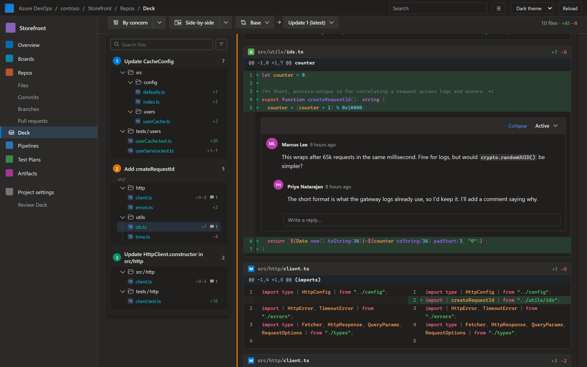
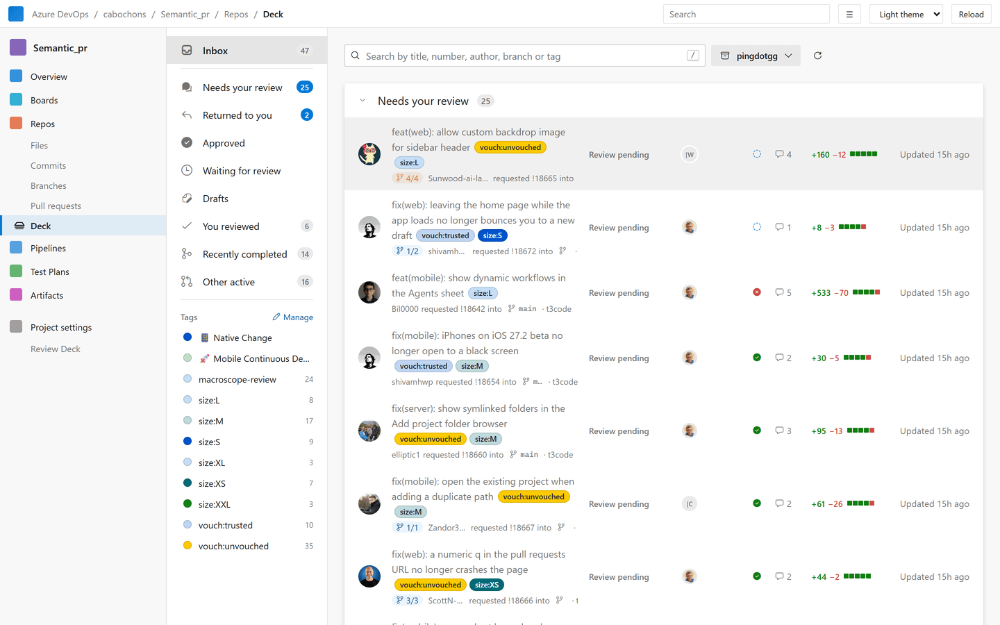
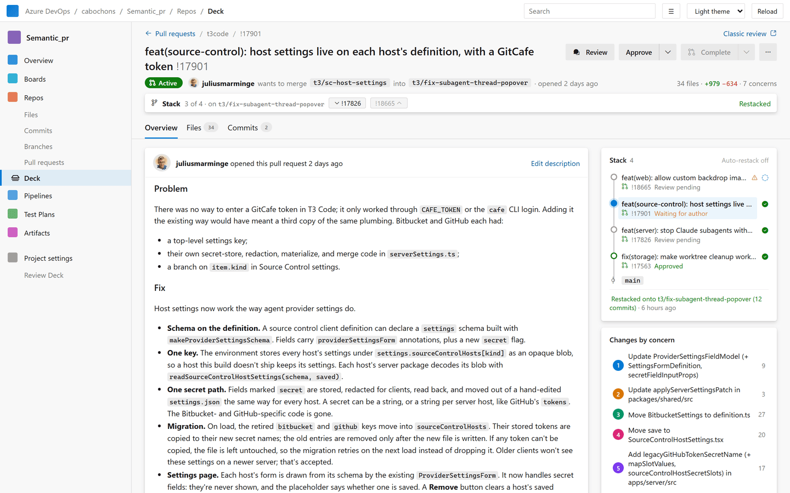
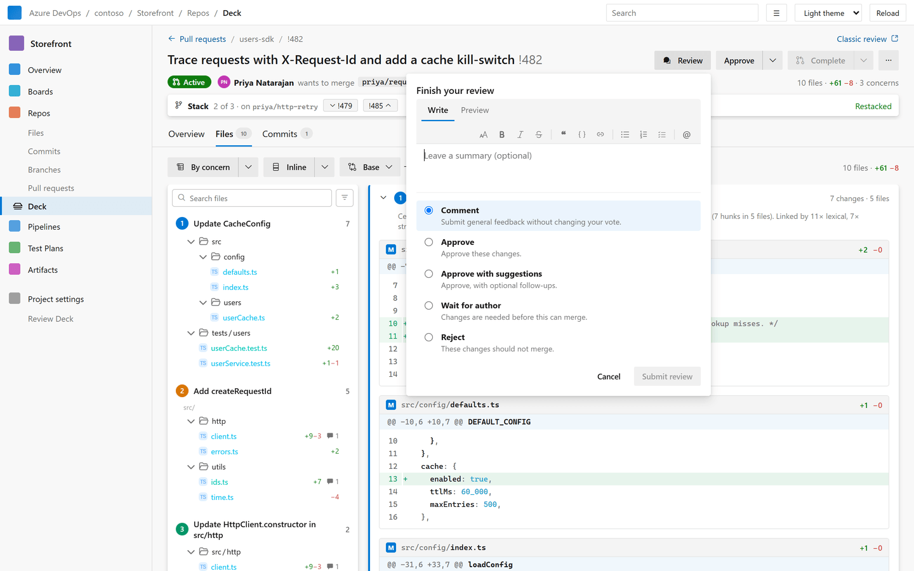

# Review Deck

**Review pull requests by concern, not by file.**

Azure DevOps lists a PR's changes alphabetically, so the schema change, the migration that uses it and the test that covers it end up far apart. Review Deck reads the diff, works out which hunks belong together, and shows each group as one concern with a title and a short explanation. You read the PR the way the author thought about it.

It replaces the pull request pages with a full-width inbox and review page, in the Azure DevOps look you already know, with light and dark themes.

## Changes grouped by concern

- **Grouped by default.** Hunks are clustered using the code's structure (definitions, references, imports, renames) parsed with tree-sitter. Each group gets a title, a one-line rationale, and its hunks ordered definitions first.
- **A–Z when you want it.** One click switches back to the plain file list. Badges show which concern each hunk landed in.
- **Fast diffs.** Inline or side-by-side, with syntax highlighting and word-level changes. A file tree shows folders, file icons and change counts.
- **Any comparison.** Compare the base or any update against any later update.
- **Big PRs stay responsive.** Grouping runs in a background worker. The diff shows up first, A–Z, and switches to grouped when it's ready (unless you've already started scrolling).

## A pull request inbox

Open **Repos › Deck** to see the pull requests that involve you, sorted into sections: *Needs your review*, *Returned to you*, *Approved*, *Waiting for review*, *Drafts*, *You reviewed*, *Recently completed* and *Other active*.

- Each row shows the PR's state, author, reviewer votes, checks, active comments, size and age.
- Filter by repository or tag, or search by title, number, author, branch or tag (press `/`).
- Move with `j` / `k` and open with `Enter`.

## Overview: the PR at a glance

- The description, editable with a Markdown preview.
- A timeline of updates, commits, votes and comment threads, with replies and thread status.
- A sidebar with **Changes by concern** (click one to jump to it), reviewers and votes, required and optional checks, tags and work items.
- Add or remove reviewers, mark them required or optional, and edit tags without leaving the page.

## Review like on GitHub

- Click a line number on either side of the diff to comment. Reply to threads and change their status in the diff or in the timeline.
- **Start a review** to collect comments as private drafts instead of posting each one. Drafts show inline as *Pending*, can be edited or deleted, and survive a page reload.
- **Finish review** posts everything at once, with a summary and your vote: Comment, Approve, Approve with suggestions, Wait for author or Reject.
- The comment editor has a formatting toolbar, Write / Preview, keyboard shortcuts (`Ctrl+B`, `Ctrl+I`, `Ctrl+E`, `Ctrl+K`, `Ctrl+Enter` to submit) and `@` mentions.

## Stacked pull requests

When a PR targets another PR's branch, Review Deck treats them as a stack. The PR page shows where you are ("Stack · 3 of 4") with links to the layers above and below, and the Overview sidebar lists the whole stack with each layer's review state and checks. Inbox rows show their position, like `2/4`.

Project administrators choose the trunk branches that stacks start from (`main`, `dev`, `release/**`, …) in **Project settings › Review Deck**. With the backend, they can also turn on **auto-restack**: when a layer changes or merges, the layers above it are rebased and retargeted on the server, with no clone or pipeline.

## Getting started

1. Install the extension in your organization.
2. Open **Repos › Deck** for your inbox, or open any pull request and choose **⋯ › Open in Review Deck**.
3. The classic Azure DevOps page is always one click away through **Classic review** in the top right.

## FAQ

**Does my code leave Azure DevOps?**
Grouping runs in your browser. Review Deck reads files through the Azure DevOps REST API with your own session and parses them on the page. Optional server features (see below) are the only exception.

**What are the optional server features?**
A build with the Review Deck backend adds two things. Sentence embeddings make the grouping more accurate; they run on the backend's own CPU, not an external AI service. **AI group titles** are written by a small language model from the PR description and the changed lines. AI titles are **off by default** in every project, and only a project administrator can turn them on. Without them, groups get rule-based titles.

**Why does it need these permissions?**
- *Code (read and write):* to read diffs, to post comments, votes, reviewers, tags and description edits that you make, and to complete or abandon a PR when you choose to.
- *Work items (read):* to show the work items linked to a PR.
- *Project and team (read):* to list your projects and repositories.
- *Service hooks (read and write):* used only by auto-restack, to hear when a PR in a stack changes.

Review Deck only writes when you act: posting a comment, voting, editing reviewers, tags or the description, or completing, abandoning or setting auto-complete. The one exception is auto-restack, which a project administrator has to turn on.

**Which languages are supported?**
Every file shows up and gets a diff. Structural grouping is deepest for TypeScript and JavaScript (including TSX/JSX), and syntax highlighting covers TS/TSX, JS/JSX, JSON, Markdown, CSS, HTML, YAML and shell scripts. Other files are grouped by their paths and shared names.

**Can I still use the normal pull request page?**
Yes. Review Deck adds pages; it doesn't remove or change the built-in ones. Use **Classic review** to switch at any time.

**Can I complete or abandon a PR from Review Deck?**
Yes. **Complete** opens the merge dialog: pick the merge type (the ones your branch policies allow), edit the merge commit message, and choose whether to complete linked work items and delete the source branch. If required checks haven't passed yet, set **auto-complete** to merge once they do, or override the policies with a reason if you have permission. Abandon, reactivate, mark as draft and publish are behind the same button.

**Are my pending review comments visible to others?**
No. Azure DevOps has no server-side pending review, so drafts stay in your browser until you choose **Finish review**.

**Does it work with Azure DevOps Server?**
It's built and tested on Azure DevOps Services (dev.azure.com).

**Where do I report a problem or ask a question?**
Use the **Q & A** tab on this page, or open an issue in the [GitHub repository](https://github.com/alextrepa/semantic-pr/issues).

## Source

Review Deck is developed at [github.com/alextrepa/semantic-pr](https://github.com/alextrepa/semantic-pr).
